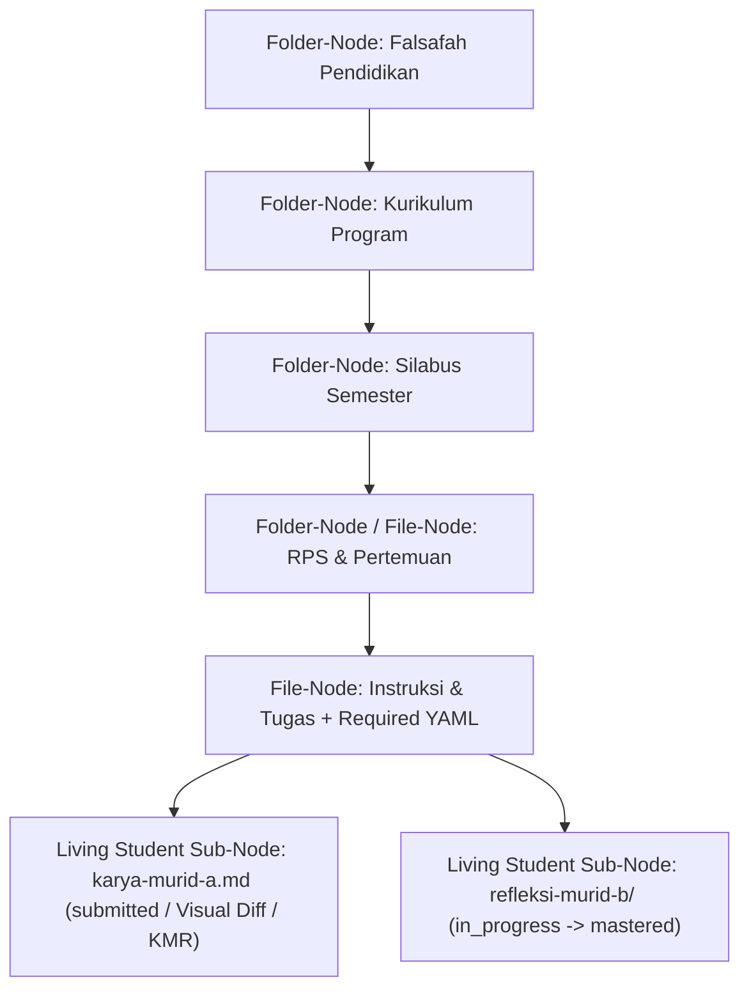
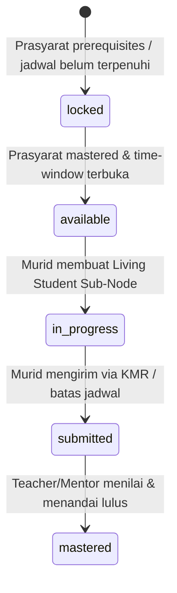

# Visi & Arsitektur `Academy` (LMS) — Living Competence Tree (`3 Lapisan Evolusi`)

## Ringkasan 3 Baris
- Memformalkan mode **`Academy`** (*Core Mode* yang terhubung 1-to-1 ke *Presentation Lens* **`course`**) sebagai **Living Pedagogical & Competence Tree**: sistem pembelajaran berbasis berkas `.md` + YAML + blok tunggal `academy` di **`.app/config.json`** (*bukan* file terpisah `lms-policy.json`).
- Memvisualisasikan hirarki pedagogis utuh **Falsafah → Kurikulum → Silabus → RPS → Instruksi/Tugas** di atas *Folder-Nodes* & *File-Nodes* deterministik (**`Deep Explorer`**: Diagram DAG / Org Chart) lengkap dengan **Living Student Sub-Nodes**.
- Menjabarkan **3 Lapisan Evolusi Implementasi** (*Structural & Living Portfolio Tree* → *Pedagogical Rules & Constraints* → *Controlled Execution Environment*) yang terintegrasi langsung dengan **Essential VCS** (*Visual Diff*, *Knowledge Merge Request*) dan kontrol peran **Give Access `AS & WITH`**.

---

## 1. Living Pedagogical & Competence Tree (*Folder-Nodes* & *File-Nodes*)

- **Gambaran Menyeluruh (`Deep Explorer` Multi-Dimensi):** Pengurus institusi (`Institution Admin`), guru/dosen (`Teacher/Mentor`), dan murid/mahasiswa (`Student`) membaca peta kurikulum yang sama lewat **4 lensa visual `Deep Explorer`** (*Diagram View* `Competence/Skill Tree DAG` & hierarki, *Graph View*, *Table View* progres & nilai YAML, serta *Cards View* modul belajar). Aturan pedagogis & kompetensinya dapat langsung dikonfigurasi lewat **`Settings Hub > Workspace > Deep Explorer`** maupun dibuka sebagai **Tab Workspace** di Editor.
- **Living Student Sub-Nodes:** Proses dan hasil belajar murid tidak terpisah di sistem database asing atau LMS silo terputus, melainkan terdokumentasi langsung sebagai **sub-nodes (`file-nodes` atau `sub-folder-nodes`)** di bawah node kurikulum/instruksi terkait—menggunakan alur *Essential VCS* (*Snapshot*, *Visual Diff*, *Knowledge Merge Request*) untuk pengumpulan & umpan balik.

### Mesin Status Progres Pembelajaran (`5-State Progression`)

---

## 2. Tiga Lapisan Evolusi Implementasi (Tersentralisasi di `.app/config.json`)

**Aturan Sentralisasi Konfigurasi:** Seluruh aturan kurikulum dan kebijakan pedagogis disimpan pada blok **`academy`** di dalam berkas konfigurasi tunggal **`.app/config.json`** (**dilarang** memisahkan ke `lms-policy.json` atau `preset.json`).

| Lapisan Evolusi | Fokus & Kemampuan Kunci | Konfigurasi & Sumber Data |
| :--- | :--- | :--- |
| **Lapisan 1: Structural & Living Portfolio Tree** | Visualisasi pohon **Folder-Node/File-Node** (`Falsafah → Kurikulum → Silabus → RPS → Instruksi/Tugas`), *pre-loaded note templates*, *required YAML properties*, *Living Student Sub-Nodes*, dan *progress tracking* (`locked` → `available` → `in_progress` → `submitted` → `mastered`). | Blok `academy.node_rules` & `schema.templates` di `.app/config.json` + YAML Frontmatter (`prerequisites`, `academy_role`, `progress`). |
| **Lapisan 2: Pedagogical Rules & Constraints** | Aturan per-folder/node yang dikelola Pengurus/Guru meliputi: **prasyarat format file** (mis. `.md`, `.pdf`), **jumlah file maksimum**, **batas ukuran (`max_size_mb`)**, **wajib/tidaknya properti YAML**, **hak akses CRUD per-node** (*Create/Read/Update/Delete*), serta **rentang waktu (`time-window` / jadwal buka-tutup)**. | Blok `academy.node_rules.<path>` dan `access.node_overrides` di `.app/config.json` (dievaluasi `PolicyEngine` ↔ Postgres RLS). |
| **Lapisan 3: Controlled Execution Environment** | Kebijakan perangkat yang diizinkan (`mobile` / `tablet` / `laptop`) dan prasyarat **`Focus / Full-Zen Screen`** terisolasi untuk mode ujian atau asesmen terfokus. | Properti `execution_environment` pada `academy.node_rules.<path>` dalam `.app/config.json` (`Stage 3`). |

---

## 3. Alur Penggunaan Institusi, Pendidik & Pelajar (`Stage 2–3`)
1. **Perancangan Kurikulum (`/app` Mode `Academy`):** Pengurus & guru membangun struktur Folder-Node/File-Node kurikulum serta mengatur aturan Lapisan 1–3 secara kontekstual per node di **`.app/config.json`**.
2. **Pemberian Akses & Publikasi Granular (`AS & WITH`):** Modul diterbitkan *as `course`* ke `/:username/:vaultSlug` (`CC BY-SA 4.0` atau lisensi institusi) maupun dibagikan secara privat ke kelas melalui peran **`Student`**, **`Teacher/Mentor`**, dan **`Institution Admin`** di **"Share · Access · Versions" Drawer**.
3. **Belajar, Submit & Umpan Balik:** Murid bekerja di dalam *Living Student Sub-Nodes*, meninjau perubahan lewat *Visual Diff*, serta mengirimkan hasil belajar lewat *Knowledge Merge Request (`KMR`)* untuk ditinjau mentor langsung per paragraf/node.

---

## Terkait
- [Master Blueprint v2.0](../00-meta/00-0-master-blueprint.md)
- [Arsitektur Data & Skema `.app/config.json`](../03-architecture/data-and-storage.md)
- [Kolaborasi Granular & Essential VCS](../03-architecture/collaboration-and-publishing.md)
- [Lima Pilar Use-Case & Workspace Modes](../01-visions/use-case-pillars.md)
- [Playbook Eksekusi (`STEP-05.1` di `../02-planning/README.md`)](../02-planning/README.md)
