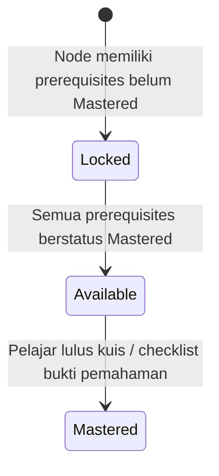

# Visi & Spesifikasi Interactive Graph LMS ObMap v2.0

## Ringkasan 3 Baris
- Mengintegrasikan kapabilitas *Learning Management System (LMS)* berorientasi **Skill Tree Directed Acyclic Graph (DAG)** langsung di atas format Markdown + YAML frontmatter tanpa *vendor lock-in*.
- Menghubungkan kurikulum publik pendidik (`PER-02`, `PER-08`) ke identitas kanonik `/:username/:vaultSlug` di `src/domains/community/` dengan lisensi terbuka default **`CC BY-SA 4.0`** serta lencana *Verified Educator/Institution* hasil kurasi Admin.
- Menjadwalkan implementasi teknis mesin evaluator prasyarat DAG, status progres simpul, dan kuis pemahaman pada Horizon 5 (`STEP-05.1`).

---

## 1. Arsitektur Skill Tree DAG Berbasis Frontmatter

Setiap catatan pembelajaran (*Learning Node*) mendefinisikan dependensinya di blok YAML terisolasi (`EditorPropertiesPanel.tsx`):
- `lms_role`: `concept` \| `module` \| `assessment`
- `prerequisites`: daftar tautan `[[note]]` prasyarat (divalidasi sebagai *Directed Acyclic Graph* tanpa siklus).
- `estimated_minutes` & `mastery_criteria`: metode kelulusan (*self-check*, kuis JSON YAML, atau kiriman *Knowledge Merge Request* tugas).
- `license`: mewarisi default vault **`CC BY-SA 4.0`** saat dipublikasikan sebagai kurikulum terbuka.

---

## 2. Alur Penggunaan Dosen, Institusi & Pelajar (`Stage 2–3`)
1. **Penulisan Modul (`/app`):** Dosen menyusun materi di Editor CM6 dan memvisualisasikan ketergantungan topik memakai solver graf deterministik.
2. **Publikasi Kanonik (`/:username/:vaultSlug`):** Kurikulum diterbitkan melalui `src/domains/community/` (menggantikan skema usang `/p/*`) sehingga pelajar anonim maupun terdaftar dapat menjelajahi peta silabus dan sitasi `[[@user/vault/note]]`.
3. **Pelacakan Progres & Fork Belajar:** Pelajar dapat membaca langsung di reader *dual-pane* atau memilih *Fork to My Vault* untuk mencatat refleksi belajar pribadi sambil melaporkan kemajuan ke widget *Productivity & Learning Analytics* pada `/vaults` (`STEP-02.1` & `STEP-05.1`).
4. **Kontrol Institusi (`Team / Academic`):** Kampus atau lab riset dapat menyebarkan kurikulum internal di *Teamspace* terkurasi (`Protected / Shared`) dengan *Admin-Locked Config* (`STEP-04.2`).

---

## Terkait
- [Lima Pilar Use-Case (`../01-visions/use-case-pillars.md`)](../01-visions/use-case-pillars.md)
- [Playbook Eksekusi (`STEP-05.1` di `../02-planning/README.md`)](../02-planning/README.md)
- [Domain Community & Rute `/:username` (`../03-architecture/adr/ADR-0007-community-domain-and-canonical-root-routing.md`)](../03-architecture/adr/ADR-0007-community-domain-and-canonical-root-routing.md)
