# Visi Platform LMS Interaktif (Interactive LMS Vision)

## Ringkasan 3 Baris
- Mendefinisikan transformasi graf pengetahuan ObMap menjadi kurikulum pembelajaran visual adaptif (*knowledge-graph LMS*).
- Menjadikan simpul (*nodes*) sebagai unit kompetensi/materi dan sisi (*edges*) sebagai relasi prasyarat belajar (*learning prerequisites*).
- Memetakan kapabilitas yang sudah ada saat ini serta rencana integrasi pelacakan progres siswa secara lokal.

---

## 1. Konsep Dasar: Kurikulum Berbasis Graf Pengetahuan

```mermaid
graph LR
    M1[Modul 1: Fondasi Markdown] --> M2[Modul 2: Arsitektur Wikilink]
    M1 --> M3[Modul 3: Manajemen File Vault]
    M2 --> M4[Modul 4: Pemetaan Graf Relasi]
    M3 --> M4
    M4 --> M5[Tugas Akhir: Portofolio Publikasi]
    
    style M1 fill:#10b981,stroke:#059669,stroke-width:2px;
    style M2 fill:#10b981,stroke:#059669,stroke-width:2px;
    style M3 fill:#3b82f6,stroke:#2563eb,stroke-width:2px;
    style M4 fill:#374151,stroke:#1f2937,stroke-width:2px;
    style M5 fill:#374151,stroke:#1f2937,stroke-width:2px;
```

*Legenda: Hijau = Selesai, Biru = Sedang Dipelajari, Abu-abu = Terkunci (Prasyarat Belum Terpenuhi).*

---

## 2. Pemetaan Kapabilitas Saat Ini vs Celah Kebutuhan

| Kapabilitas Diperlukan | Fitur ObMap Saat Ini | Celah yang Harus Dibangun | Status |
| :--- | :--- | :--- | :--- |
| **Hierarki & Urutan Materi** | Mode Timeline & Org Chart `[IMPLEMENTED]` | Logika penguncian simpul (*locked prerequisites*) | `[PLANNED]` |
| **Penyajian Konten Modul** | CodeMirror 6 & Reading Mode `[IMPLEMENTED]` | Kuis interaktif inline berbasis Markdown | `[VISION]` |
| **Pelacakan Progres Siswa** | Local IndexedDB persistence `[IMPLEMENTED]` | Store status centang modul (*learning progress store*) | `[PLANNED]` |
| **Distribusi Materi Kelas** | Public Reader Portal `/p/*` `[IMPLEMENTED]` | Portal kelas dengan autentikasi grup siswa | `[VISION]` |

---

## Terkait
- [Empat Pilar Kasus Penggunaan](../01-vision/use-case-pillars.md)
- [Peta Jalan Pengembangan Produk](../02-planning/roadmap.md)