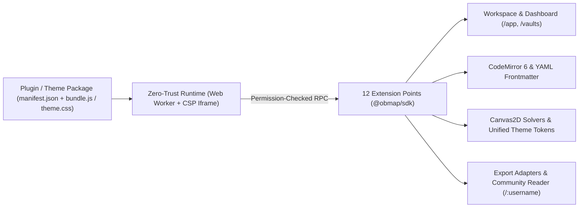

# Portal Pengembang Ekstensi & Tema ObMap (`@obmap/sdk`)

## Ringkasan 3 Baris
- Rujukan resmi pengembang pihak ketiga untuk memperluas Workspace (`/app`), Dashboard (`/vaults`), Editor CodeMirror 6, Canvas2D Graph, dan tema publik `/:username` **tanpa memodifikasi source code inti ObMap**.
- Mengadopsi standar kejelasan ekosistem pengembang bergaya Obsidian yang dipadukan arsitektur keamanan modern (**Web Worker + Iframe CSP Sandbox** dan *Permission Manifest*).
- Mendokumentasikan evolusi kontrak dari registry internal (`pluginRegistry.ts`, `configRegistry.ts`, `schemaRegistry.ts`) menuju rilis penuh `@obmap/sdk` pada `STEP-05.3` (`Stage 3`).

---

## 1. Arsitektur Ekosistem Ekstensibilitas

### Status Implementasi Saat Ini vs. Target `STEP-05.3`
- **Pondasi Aktif (`[PARTIAL]`):** Di `src/domains/settings/shared/api/` dan `src/domains/workspace/` sudah terdapat `pluginRegistry.ts`, `configRegistry.ts`, `schemaRegistry.ts`, `registerConfigSections.ts`, `WorkspaceViewRegistry.tsx`, dan `shared/api/CommandRegistry.ts`.
- **Target `@obmap/sdk` (`[PLANNED]` pada `STEP-05.3`):** Membungkus registry internal tersebut di balik jembatan RPC terisolasi, *Permission Manifest* granular, *Scoped CSS Snippets* tersanitasi, serta **Enterprise Allowlist** di `/admin`.

---

## 2. Peta Bacaan Pengembang

| Urutan | Dokumen | Fokus Bahasan |
| :---: | :--- | :--- |
| **1** | [**SDK Quickstart Guide**](plugin-sdk-quickstart.md) (`DOC-DEV-001`) | Struktur paket, `manifest.json`, lifecycle `activate()`, perintah pertama, dan pengujian lokal `.obmap/`. |
| **2** | [**12 Extension Points Reference**](extension-points-reference.md) (`DOC-DEV-002`) | Spesifikasi teknis seluruh 12 titik kait (*Workspace, Dashboard, Config, CM6, Graph, Export*) dan izinnya. |
| **3** | [**Unified Theme & Scoped CSS Guide**](theme-authoring-guide.md) (`DOC-DEV-003`) | Token desain DOM ↔ Canvas2D (`--ob-*`), mode `refresh()` kanvas, dan aturan *Scoped CSS Snippets*. |
| **4** | [**Security, Permissions & Sandbox Model**](security-and-sandbox.md) (`DOC-DEV-004`) | Arsitektur isolasi Worker/Iframe CSP, deklarasi permission manifest, larangan kebocoran token, & audit review. |

---

## Terkait
- [ADR-0011: 6-Layer Config & Unified Theme Engine](../03-architecture/adr/ADR-0011-six-layer-cascading-config-and-unified-theme-engine.md)
- [ADR-0012: Sandboxed `@obmap/sdk` & Extension Points](../03-architecture/adr/ADR-0012-sandboxed-plugin-sdk-and-extension-points.md)
- [Playbook Eksekusi (`STEP-01.5` & `STEP-05.3` di `02-planning/README.md`)](../02-planning/README.md)
