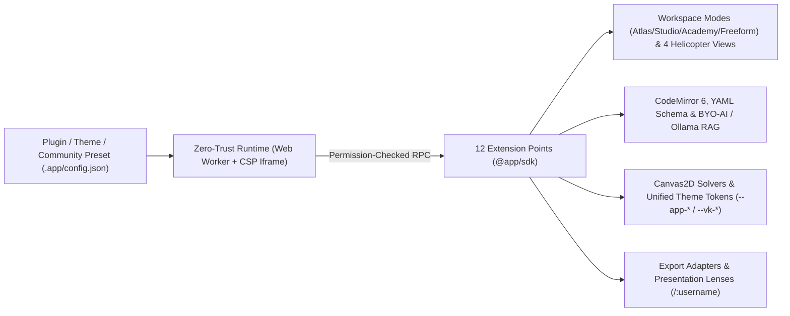

# Portal Pengembang Ekstensi, Presets & Tema (`@app/sdk`)

## Ringkasan 3 Baris
- Rujukan resmi pengembang pihak ketiga dan pembuat **Community Presets** untuk memperluas Workspace (`/app`), Dashboard (`/vaults`), **4 Helicopter Views** (*Graph, Diagram, Table, Cards*), Editor CodeMirror 6, AI/PDF workflows, dan tema publik `/:username` tanpa memodifikasi kode sumber inti.
- Mengadopsi standar kejelasan ekosistem pengembang bergaya Obsidian × Nodus dengan keamanan **Web Worker + Iframe CSP Sandbox**, *Permission Manifest*, dan sentralisasi konfigurasi pada blok **`extensions`** & **`schema`** di **`.app/config.json`**.
- Mendokumentasikan evolusi kontrak dari registry internal (`pluginRegistry.ts`, `configRegistry.ts`, `schemaRegistry.ts`) menuju rilis penuh **`@app/sdk`** (sebelumnya direferensikan sebagai `@vk/sdk`) pada `STEP-05.3`.

---

## 1. Arsitektur Ekosistem Ekstensibilitas & Sentralisasi `.app/config.json`

### Status Implementasi Saat Ini vs. Target `STEP-05.3`
- **Pondasi Aktif (`[PARTIAL]`):** Di `src/domains/settings/shared/api/` dan `src/domains/workspace/` sudah terdapat `pluginRegistry.ts`, `configRegistry.ts`, `schemaRegistry.ts`, `registerConfigSections.ts`, `WorkspaceViewRegistry.tsx`, dan `CommandRegistry.ts`.
- **Target `@app/sdk` (`[PLANNED]` pada `STEP-05.3`):** Membungkus registry internal di balik RPC terisolasi, menyatukan seluruh state plugin/schema/preset ke **`.app/config.json`** (dilarang membuat `preset.json` / `lms-policy.json` / `setting.json` terpisah; fallback baca dari `.vk/`/`.obmap/`), serta **Enterprise Allowlist** di `/admin`.

---

## 2. Peta Bacaan Pengembang

| Urutan | Dokumen | Fokus Bahasan |
| :---: | :--- | :--- |
| **1** | [**SDK Quickstart Guide**](plugin-sdk-quickstart.md) (`DOC-DEV-001`) | Struktur paket `my-app-citation-helper`, `manifest.json`, integrasi blok `extensions` `.app/config.json`, & `.app/plugins/` (fallback `.vk/`/`.obmap/`). |
| **2** | [**12 Extension Points Reference**](extension-points-reference.md) (`DOC-DEV-002`) | Spesifikasi teknis seluruh 12 titik kait (*Workspace, 4 Helicopter Views, Dashboard, Config, CM6, Graph, Export*) dan izinnya. |
| **3** | [**Unified Theme & Scoped CSS Guide**](theme-authoring-guide.md) (`DOC-DEV-003`) | Token desain DOM ↔ Canvas2D (`--app-*` / `--vk-*`), pemicu `refresh()`, dan aturan *Scoped CSS Snippets*. |
| **4** | [**Security, Permissions & Sandbox Model**](security-and-sandbox.md) (`DOC-DEV-004`) | Arsitektur isolasi Worker/Iframe CSP, manifest izin (termasuk `ai:local`/Ollama & `network`), & *Enterprise Allowlist*. |

---

## Terkait
- [Arsitektur Data & Single `.app/config.json`](../03-architecture/data-and-storage.md)
- [ADR-0011: 6-Layer Config & Unified Theme Engine](../03-architecture/adr/ADR-0011-six-layer-cascading-config-and-unified-theme-engine.md)
- [ADR-0012: Sandboxed `@app/sdk` & Extension Points](../03-architecture/adr/ADR-0012-sandboxed-plugin-sdk-and-extension-points.md)
- [Playbook Eksekusi (`STEP-01.5` & `STEP-05.3` di `02-planning/README.md`)](../02-planning/README.md)
