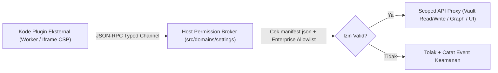

# Model Keamanan Ekstensi, Izin & Sandbox (`Security & Sandbox`)

## Ringkasan 3 Baris
- Mendefinisikan batas keamanan *Zero-Trust* untuk seluruh plugin pihak ketiga `@obmap/sdk` guna melindungi kredensial auth Supabase, berkas lokal `FileSystemService.ts`, dan sesi kolaborasi tim.
- Menjelaskan pemisahan eksekusi melalui **Web Worker terisolasi** (komputasi) serta **Iframe ber-CSP ketat** (`sandbox="allow-scripts"`) untuk panel UI, tanpa akses langsung ke DOM induk.
- Menetapkan skema **Permission Manifest** granular dan mekanisme **Enterprise Allowlist** di konsol `/admin`.

---

## 1. Batas Keamanan Sandbox (*Threat Model & Isolation*)

### Larangan Absolut Sandbox
1. **Tanpa Akses Kredensial & Storage Browser:** Ekstensi tidak dapat membaca `document.cookie`, `localStorage`, `sessionStorage`, atau klien auth Supabase secara langsung.
2. **Tanpa URL Privat Eksplisit:** Pemrosesan media privat dari bucket `vault-media` dan `avatars` ditangani seluruhnya oleh host melalui `createSignedUrl` ber-TTL pendek; plugin hanya menerima URI render sementara yang aman.
3. **Tanpa Script Inline di Konten Publik:** `MarkdownPostProcessor` dan *Scoped CSS Snippets* di domain `community` wajib lolos sanitasi (`rehype-sanitize` & CSS property allowlist).

---

## 2. Kamus Izin *Permission Manifest* (`manifest.json`)

| Scope Izin | Cakupan Akses yang Dibuka | Risiko & Kebijakan Review |
| :--- | :--- | :--- |
| **`ui:only`** | Mendaftarkan command palette, ribbon/status bar, view Iframe terisolasi, & section config. | Rendah — Default aman tanpa akses konten file. |
| **`metadata:read`** | Membaca daftar node, tags, backlink, & skema frontmatter vault aktif (read-only). | Rendah — Cocok untuk analitik belajar & alat sitasi. |
| **`graph:read`** | Menerima salinan array node & edge guna solver deterministik atau dekorator tema. | Rendah — Dibatasi timeout komputasi Worker. |
| **`vault:read`** | Membaca isi berkas Markdown dari vault yang dibuka secara eksplisit oleh pengguna. | Sedang — Memerlukan persetujuan pengguna saat instalasi. |
| **`vault:write`** | Membuat atau mengubah berkas Markdown & YAML frontmatter dalam batas role `PolicyEngine`. | Tinggi — Diblokir otomatis bila user berstatus `viewer` / `downgraded_readonly`. |
| **`network:<host>`** | Melakukan fetch HTTP/HTTPS eksklusif ke daftar domain spesifik (mis. `api.crossref.org`). | Tinggi — Diwajibkan audit manual sebelum masuk direktori komunitas & tunduk CSP. |

---

## 3. Tata Kelola Enterprise & Checklist Uji Keamanan (`STEP-05.3`)
- Admin Organisasi (`Team / Academic`) dapat mengaktifkan mode **Approved Plugins Only** pada `/admin` (`Org-Lock Policy`, `ADR-0011`) sehingga anggota lab/perusahaan hanya bisa memasang ekstensi dari *Enterprise Allowlist*.
- Setiap pengajuan plugin publik wajib lolos uji otomatis (`STEP-05.3`): tidak memuat panggilan `eval`/`new Function`, patuh deklarasi CSP, dan membuang seluruh langganan event di `deactivate()`.

---

## Terkait
- [ADR-0012: Sandboxed `@obmap/sdk` & Extension Points](../03-architecture/adr/ADR-0012-sandboxed-plugin-sdk-and-extension-points.md)
- [SDK Quickstart Guide (`plugin-sdk-quickstart.md`)](plugin-sdk-quickstart.md)
- [Referensi 12 Extension Points (`extension-points-reference.md`)](extension-points-reference.md)
- [Strategi Pengujian (`../05-engineering/testing-strategy.md`)](../05-engineering/testing-strategy.md)
