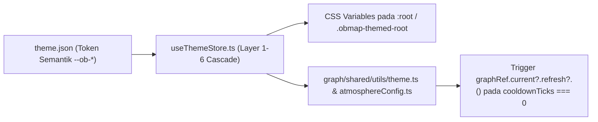

# Panduan Pembuatan Tema & Scoped CSS Snippets (`Theme Authoring`)

## Ringkasan 3 Baris
- Menjelaskan cara merancang tema visual terpadu yang mengubah tampilan antarmuka DOM (Tailwind/Radix) sekaligus rendering kanvas Canvas2D secara serentak (`ADR-0011`).
- Mendokumentasikan integrasi `useThemeStore.ts` ke `src/domains/graph/shared/utils/theme.ts` dan `atmosphereConfig.ts` beserta kewajiban pemicuan `graphRef.current?.refresh?.()`.
- Menetapkan standar keamanan penulisan **Scoped CSS Snippets** untuk vault pribadi maupun portofolio publik `/:username`.

---

## 1. Unified Design Token Bridge (DOM ↔ Canvas2D)

### Daftar Token Semantik Wajib
Setiap tema ObMap minimal mendefinisikan kelompok token berikut pada berkas `theme.json`:
- **Permukaan & Teks DOM:** `--ob-bg-canvas`, `--ob-bg-surface`, `--ob-bg-elevated`, `--ob-border-subtle`, `--ob-text-primary`, `--ob-text-muted`, `--ob-accent-primary`.
- **Kanvas Graf Canvas2D (`theme.ts` & `atmosphereConfig.ts`):** `--ob-graph-node-default`, `--ob-graph-node-evergreen`, `--ob-graph-node-locked`, `--ob-graph-edge-default`, `--ob-graph-edge-citation`, `--ob-graph-label-bg`.
- **Tipografi & Sudut:** `--ob-font-sans`, `--ob-font-mono`, `--ob-font-display`, `--ob-radius-md`.

> **Catatan Arsitektural:** Karena mode deterministik (`Mindmap`, `Org`, `Timeline`, `Fishbone`, dll.) merender kanvas statis (`cooldownTicks === 0`), pergantian token tema secara otomatis memanggil `graphRef.current?.refresh?.()` agar perubahan warna simpul langsung terlihat tanpa memuat ulang tab.

---

## 2. Scoped CSS Snippets (Gaya Komunitas Ala Obsidian yang Aman)
1. **Lingkup Workspace Privat (`.obmap/snippets/*.css`):** Pengguna dapat menyesuaikan kerapatan sidebar, gaya callout Markdown, atau font pembaca.
2. **Lingkup Halaman Publik (`/:username` di `domains/community/`):**
   - Seluruh selektor CSS otomatis di-*scope* ke kontainer akar `.obmap-themed-root`.
   - Aturan CSS yang mengandung `javascript:`, `@import` ke domain eksternal tak tepercaya, atau properti berbahaya ditolak oleh parser sanitasi sebelum tayang publik.
3. **Kepatuhan Aksesibilitas & Org-Lock:** Tema resmi direktori komunitas wajib memenuhi rasio kontras teks WCAG 2.2 AA (`>= 4.5:1`), serta tunduk pada penguncian kebijakan apabila admin organisasi menetapkan *Org-Locked Theme* (`ADR-0011`).

---

## Terkait
- [ADR-0011: Six-Layer Config & Unified Theme Engine](../03-architecture/adr/ADR-0011-six-layer-cascading-config-and-unified-theme-engine.md)
- [Layout Engine (`../03-architecture/layout-engine.md`)](../03-architecture/layout-engine.md)
- [Security & Sandbox Model (`security-and-sandbox.md`)](security-and-sandbox.md)
