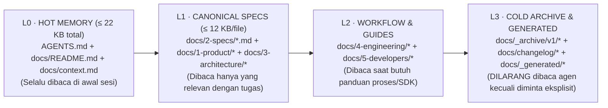

# MASTER PROMPT — Sidra Docs v2, Git-Branch Workflow & Automated App Versioning

> **Cara Pakai:** Copy seluruh isi file ini ke sesi chatting eksekusi yang baru (bisa dikombinasikan dengan `/goal`).

---

## 0. Konteks, Data Audit Aktual & Tujuan

Kamu akan **membangun ulang sistem dokumentasi (`docs/` v2), sistem alur kerja Git branch, serta sistem otomasi App & Git Versioning** untuk aplikasi **Sidra** (repo `obmap-meed`).

### Temuan Audit Repo Saat Ini (Baseline Faktual):
1. **Beban Konteks `docs/` v1:** 67 file (±648 KB ≈ 150–200 ribu token). File terbesar justru `docs/changelogs/2026-11.md` (69 KB) dan `docs/_machine/changelog.jsonl` (56 KB, rata-rata 1.581 karakter/entri).
2. **Duplikasi & Drift:** Satu konsep diulang di 5–8 file. Masih ada 45 sebutan `.vk/` / `@vk/sdk`, 10 sebutan `Helicopter`, dan folder `src/domains/public-reader/` (12 file) masih ada padahal `AGENTS.md` menyebut sudah dilebur ke `community`.
3. **Pemborosan Token Jalur Mockup (`src/prototype/`):** `src/prototype/` kini membengkak menjadi **70 file** (dengan 21 import ke `@/domains/*`). Memelihara aplikasi kembar di `src/prototype/` lalu menulis ulang ke `src/domains/` dan menyalin lagi ke `snapshots/` menghabiskan hingga 3× lipat token.
4. **Tidak Ada Standar App & Git Versioning:**
   - `package.json` masih tertulis `"name": "vite_react_shadcn_ts"` dan `"version": "0.0.0"`.
   - Jumlah `git tag` di repo saat ini adalah **0 (kosong)**.
   - Riwayat versi selama ini ditulis manual di pesan commit (`491e250 sidra-v.1.0`, `d900a1e sidra-v.1.1-(graph-fixed)`, `9042222 sidra-v.1.2-(graph-fixed)`, `14c762c sidra-v.1.2.1-(proto-dev)`, `51953e0 sidra-v.1.2.2-(proto-docs-dev)`, `5a2b47f sidra-v.1.2.3-(proto-docs-dev)`, `953c36b sidra-v.1.2.4-(back-to-sidra-v1.0-with-docs-v2)`), dan sebelum itu banyak commit bernama `Changes` atau `Work in progress`.

**Target:** Setiap metrik dari 10 dimensi Scorecard (Bagian 10) wajib mencapai **minimal 9.0/10** berdasarkan pengecekan script otomatis (`npm run docs:check`), dan seluruh proses **versioning, changelog, index, serta git tagging** berjalan **otomatis lewat script** oleh agen di masa depan.

---

## 1. Keputusan Arsitektur yang Sudah Dikunci (Jangan Diperdebatkan Ulang)

| ID | Keputusan Final |
| :--- | :--- |
| **D1** | **Bangun `docs/` v2 yang baru, sederhana, dan terpusat (4 Lapis Memori L0–L3).** Pindahkan seluruh `docs/` v1 **utuh tanpa diedit** ke `docs/_archive/v1/`. |
| **D2** | **Pensiunkan sistem pengembangan mockup terpisah (`src/prototype/`).** Mulai sekarang seluruh eksperimen UI/UX dan fitur dilakukan lewat **Git Branch** langsung pada aplikasi utama (`src/domains/`). Di tugas ini `src/prototype/` (70 file hasil commit `953c36b`) **jangan dihapus dulu**: bekukan sebagai *read-only reference* untuk migrasi ke `src/domains/`, dan jangan menambah fitur baru di `src/prototype/`. |
| **D3** | **Snapshot = Git Tag Berversi + Automated Release Script.** Tidak ada lagi penyalinan folder source code ke `src/prototype/snapshots/`. Setiap versi/stage dikunci dengan annotated Git tag resmi (`vX.Y.Z`). |
| **D4** | **Standarisasi Identitas & Konfigurasi:** Nama aplikasi di `package.json` diubah menjadi `"sidra-app"`. Konfigurasi vault/workspace terpusat di **1 file tunggal `.app/config.json`** dan SDK **`@app/sdk`** (`.vk/` & `.obmap/` hanya sebagai *legacy read-only fallback*). |
| **D5** | **Automated App & Git Versioning (SemVer):** `package.json` adalah *Single Source of Truth* untuk nomor versi aplikasi (dimulai dari backfill `v1.0.0` s/d `v1.2.4`, dan rilis tugas ini menjadi **`v1.3.0`**). Agen ke depan wajib menaikkan versi, mengupdate changelog, dan membuat Git tag secara otomatis melalui script `npm run release`. |
| **D6** | **Diet Changelog & Scripts over Tokens:** Agen cukup menulis **1 baris ringkas (≤ 280 karakter)** di `docs/changelog/changelog.jsonl` (atau lewat argumen `npm run release`). File `CHANGELOG.md`, `llms.txt`, `docs/_generated/index.json`, `features.json`, `scorecard.md`, dan `src/global/config/version.generated.ts` semuanya **di-generate otomatis oleh script Node.js**. |
| **D7** | **Zero Product Knowledge Loss:** Seluruh keputusan produk dan arsitektur dari v1 (filosofi, visi, misi, motto, 6 prinsip, non-goals [bukan Trello/Asana/ClickUp], 3 level user, 6 sistem referensi [Obsidian, Nodus Research, XMind, Notion, Wikipedia, LinkedIn×RG×GitHub], Workspace Modes [`Freeform`, `Atlas`, `Studio`, `Academy` + roadmap `Scholar`], `Deep Explorer` 4 lensa, Unified `Settings Hub` dengan *Interactive Breadcrumb Dropdown + Right Sidebar* dan urutan `Account → Workspace → Vault` [13 sub-setting], `Share · Access · Versions` [`AS & WITH`], Academy 3 lapisan, 3-stage release gate, rute kanonik `/:username`, RLS & private storage) **wajib masuk ke `docs/` v2**. |

---

## 2. Arsitektur Memori 4 Lapis (L0–L3) & Aturan Gaya Penulisan

Agar agen hemat token tetapi tidak pernah kehilangan konteks, `docs/` v2 dibagi menjadi **4 Lapis Memori**:



### Lima Prinsip Penulisan Docs v2:
1. **Satu Konsep = Satu File Spec (DRY Mutlak):** Istilah didefinisikan di `glossary.md`; aturan fitur didefinisikan di `docs/2-specs/<fitur>.md`. Dokumen lain **cukup menautkan**, dilarang menyalin ulang penjelasannya.
2. **Kebenaran di Atas Visi:** Status `done` atau `partial` pada spec **wajib** mencantumkan path file kode di field frontmatter `code: [...]` yang benar-benar ada di disk (diverifikasi oleh `npm run docs:check`).
3. **Script di Atas Token (*Scripts over Tokens*):** Jangan pernah menggunakan token LLM untuk membuat daftar indeks, menyusun tabel changelog bulanan, melakukan rename massal lintas puluhan file, atau menghitung nomor versi secara manual. Gunakan script Node.js.
4. **Bahasa Polos, Padat, Tanpa Jargon Kosong:**
   - Gunakan tabel, daftar poin, dan *Acceptance Criteria* (`AC-1`, `AC-2`) yang bisa diuji.
   - Hindari kata hiperbolis ("disruptif", "konstitusi suci", "high-signal", "revolusioner").
   - Maksimal kedalaman heading adalah `###` (H3).
5. **Bahasa:** Penjelasan dalam Bahasa Indonesia yang lugas; nama file, key frontmatter, istilah teknis, tipe, dan ID dalam bahasa Inggris.

---

## 3. Struktur Direktori Target (`docs/` v2)

```text
AGENTS.md                                  ≤ 8 KB   — [L0] Aturan kerja utama agen, arsitektur, & perintah otomatis
llms.txt                                   GENERATED — Indeks ringkas untuk LLM (dibuat oleh docs:build)
src/global/config/version.generated.ts     GENERATED — Versi aplikasi & git tag aktif (dibuat oleh docs:build)
docs/
  README.md                                ≤ 4 KB   — [L0] Peta navigasi & aturan baca 4 lapis (L0–L3)
  context.md                               ≤ 10 KB  — [L0] Versi aktif, stage aktif, branch, 3-5 next tasks, known issues
  1-product/
    product.md                             ≤ 15 KB  — [L1] Filosofi, visi, misi, motto, 6 prinsip, non-goals,
                                                      3 level user, 6 sistem referensi, matriks perbandingan
    glossary.md                            ≤ 10 KB  — [L1] Kamus istilah kanonik + tabel istilah lama/terlarang (banned terms)
    roadmap.md                             ≤ 8 KB   — [L1] Tahapan rilis & tabel status fitur (tabel di-generate dari specs)
  2-specs/                                 ≤ 12 KB/file — [L1] Satu konsep/fitur = satu file spec
    _template.md
    workspace-modes.md                     — Freeform, Atlas, Studio, Academy (+ roadmap Scholar), preset catalog & validasi
    deep-explorer.md                       — 4 lensa (Graph, Diagram, Table, Cards), Group By, Virtual vs Physical Sync
    settings-hub.md                        — Single adaptive component (Tab vs Full Page /settings), Breadcrumb Outline +
                                             Right Sidebar, urutan Account → Workspace → Vault (13 sub-setting)
    app-config.md                          — Skema tunggal .app/config.json, validator, & legacy fallback (.vk/.obmap)
    share-access-versions.md               — Publish AS & WITH, Give Access AS & WITH, Essential VCS (Snapshot, Diff, KMR)
    academy.md                             — Pohon kompetensi (Falsafah→RPS→Instruksi), student sub-nodes, 3 lapisan policy
    editor.md                              — Header 3-zona Instagram-style, workspace tabs/split, pin-able non-blur sidebars,
                                             Obsidian-style bottom sidebar vault switcher, isolated YAML properties panel
    graph-engine.md                        — Free-Force vs Deterministic Solvers, Hierarchical Store Bridge, canvas refresh
    vault-storage.md                       — Local-first (FS API + IndexedDB), struktur node/file, import & export vault
    sync.md                                — Cloud sync, offline queue, conflict resolution
    auth-and-roles.md                      — Auth, RBAC, 3-stage release gate (Partner → Approval Beta → GA), session activity
    explore.md                             — Direktori /explore, filter lens & preset, Quick Peek, Fork with Preset
    profile.md                             — Rute kanonik /:username & /@:username, kurasi portofolio, konstelasi, sitasi
    dashboard.md                           — Vaults dashboard overview, statistik, & insight
    onboarding.md                          — Sandbox landing & alur aktivasi < 90 detik
    billing.md                             — Entitlements & kuota server-side (Stage 3 GA)
    ai.md                                  — BYO-AI & Local Ollama / WebLLM roadmap
    sdk-and-themes.md                      — @app/sdk extension points & Unified DOM/Canvas2D Theme Engine
  3-architecture/
    overview.md                            ≤ 10 KB  — [L1] Stack, routing table, peta domain aktual, alur state Zustand
    data-and-security.md                   ≤ 10 KB  — [L1] Skema Supabase, aturan migrasi SQL, RLS, private buckets (createSignedUrl)
    decisions/                             ≤ 4 KB/file — [L1] Architecture Decision Records (ADR ringkas)
      _template.md
      0001-....md s/d 0018-....md
  4-engineering/
    workflow.md                            ≤ 10 KB  — [L2] Git-Branch workflow, 3 jalur kerja (A/B/C), & aturan hemat token
    versioning.md                          ≤ 8 KB   — [L2] Standar SemVer Sidra, konvensi Git Tag, Conventional Commits, & otomasi release
    coding-rules.md                        ≤ 10 KB  — [L2] 10 aturan arsitektur kode (Headless Controller, Store Bridge, dll.)
    testing.md                             ≤ 6 KB   — [L2] Strategi pengujian, test baseline, & Definition of Done
    docs-rules.md                          ≤ 6 KB   — [L2] Standar penulisan docs v2 & rumus 10 metrik Scorecard
    prompts.md                             ≤ 5 KB   — [L2] 4 template prompt pendek berbasis tautan spec
  5-developers/
    README.md                              ≤ 6 KB   — [L2] Portal ringkas pengembang plugin `@app/sdk` & pembuat tema
    plugin-quickstart.md                   ≤ 8 KB   — [L2] Panduan cepat membuat plugin & preset komunitas
    theme-guide.md                         ≤ 6 KB   — [L2] Panduan token tema DOM & Canvas2D
  changelog/
    changelog.jsonl                        [L3] Satu-satunya file riwayat yang ditambah 1 baris per tugas
    CHANGELOG.md                           [L3] GENERATED — Dikelompokkan otomatis per versi (vX.Y.Z) & tanggal
  _generated/
    index.json                             [L3] GENERATED — Daftar seluruh dokumen aktif + ringkasan & ukuran
    features.json                          [L3] GENERATED — Diekstrak otomatis dari frontmatter docs/2-specs/*.md
    scorecard.md                           [L3] GENERATED — Hasil audit otomatis 10 metrik dari npm run docs:check
  _archive/
    v1/                                    [L3] Seluruh isi docs/ lama (67 file) dipindah utuh tanpa diedit
    MIGRATION-MAP.md                       [L3] Tabel pemetaan 100% file v1 → lokasi barunya di v2
```

**Batas Ukuran Ketat (Dicek Otomatis oleh `docs:check`):**
- Total bacaan wajib L0 (`AGENTS.md` + `docs/README.md` + `docs/context.md`) **≤ 22 KB**.
- Total seluruh dokumen aktif (di luar `_archive/`, `changelog/`, `_generated/`) **≤ 250 KB**.

---

## 4. Sistem App & Git Versioning Otomatis (`4-engineering/versioning.md` & Scripts)

Selama ini tidak ada patokan versi yang baku. Mulai sekarang, Sidra menggunakan **Automated Semantic Versioning (SemVer 2.0.0) + Git Tagging** yang dijalankan otomatis lewat script.

### 4.1 Patokan Versi (`MAJOR.MINOR.PATCH` + Pre-Release)

Format versi aplikasi di `package.json` adalah `X.Y.Z` (dan format Git tag adalah `vX.Y.Z`):

| Komponen | Kapan Dinaikkan | Contoh | Pemicu Otomatis (`type` di Commit / Changelog) |
| :--- | :--- | :--- | :--- |
| **MAJOR (`X.0.0`)** | Perubahan generasi arsitektur besar atau pembukaan Stage Rilis utama (mis. cutover penuh ke v2.0 Production). | `1.3.0` → `2.0.0` | Flag `--major` atau `BREAKING CHANGE` |
| **MINOR (`1.Y.0`)** | Penambahan fitur baru, penyelesaian 1 spec/stage di `main`, atau perombakan sistem besar (seperti Docs v2 + Versioning ini). | `1.2.4` → `1.3.0` | `type: "feat"` atau `--minor` |
| **PATCH (`1.3.Z`)** | Perbaikan bug, refactor internal tanpa ubah fitur, pembaruan docs rutin, penambahan test, atau chore. | `1.3.0` → `1.3.1` | `type: "fix" \| "refactor" \| "docs" \| "test" \| "chore"` atau `--patch` |
| **PRE-RELEASE (`1.4.0-exp.<nama>.1`)** | Checkpoint di branch eksperimen (`exp/*`) sebelum siap di-merge ke `main`. | `1.4.0-exp.canvas.1` | `type: "exp"` atau `--prerelease <nama>` |

### 4.2 Backfill Git Tag Historis (Menertibkan Riwayat Lama)

Di dalam tugas ini, buat dan jalankan script/perintah untuk menempelkan **annotated Git tag** pada commit-commit milestone terdahulu agar riwayat Git repo langsung rapi dan konsisten:

| Commit Hash | Pesan Commit Lama | Git Tag Standar yang Dipasang |
| :--- | :--- | :--- |
| `491e250` | `sidra-v.1.0` | `v1.0.0` |
| `d900a1e` | `sidra-v.1.1-(graph-fixed)` | `v1.1.0` |
| `9042222` | `sidra-v.1.2-(graph-fixed)` | `v1.2.0` |
| `14c762c` | `sidra-v.1.2.1-(proto-dev)` | `v1.2.1` |
| `51953e0` | `sidra-v.1.2.2-(proto-docs-dev)` | `v1.2.2` |
| `5a2b47f` | `sidra-v.1.2.3-(proto-docs-dev)` | `v1.2.3` |
| `953c36b` | `sidra-v.1.2.4-(back-to-sidra-v1.0-with-docs-v2)` | `v1.2.4` |
| *(Commit tugas ini)* | `docs(v2): rebuild layered docs v2 and automated git versioning [v1.3.0]` | **`v1.3.0`** |

*(Catatan: Script backfill harus mengecek `git rev-parse --verify` terlebih dahulu agar aman dan idempoten jika tag sudah ada).*

### 4.3 Sinkronisasi Versi Satu Pintu (*Single Version Source of Truth*)

1. **`package.json`:** Ubah `"name": "sidra-app"` dan `"version": "1.3.0"`.
2. **`src/global/config/version.generated.ts` (Di-generate oleh `npm run docs:build`):**
   ```ts
   // AUTO-GENERATED BY scripts/docs/build.mjs — DO NOT EDIT MANUALLY
   export const APP_VERSION = "1.3.0";
   export const APP_VERSION_TAG = "v1.3.0";
   export const APP_RELEASE_DATE = "2026-11-20";
   ```
   *(File ini aman dan tidak mengubah logika domain, serta bisa dipakai oleh UI StatusBar / Settings Hub untuk menampilkan versi aplikasi secara akurat).*
3. **`docs/context.md` frontmatter:** Memiliki field `version: 1.3.0` yang selalu diverifikasi cocok dengan `package.json` oleh `npm run docs:check`.

### 4.4 Script Otomasi Rilis & Versioning untuk Agen (`npm run release`)

Buat `scripts/version/release.mjs` yang dihubungkan ke `"release": "node scripts/version/release.mjs"` di `package.json`.

**Cara kerja `npm run release` (1 perintah untuk agen di setiap akhir tugas):**
Contoh pemanggilan oleh agen:
```bash
npm run release -- --type feat --area settings,workspace --specs docs/2-specs/settings-hub.md --summary "Migrate Settings Hub breadcrumb and 13 sub-settings to main-app"
```
Atau mode bump versi saja tanpa auto-commit (jika agen ingin commit manual):
```bash
npm run release -- --type patch --area docs --summary "Clarify Deep Explorer AC-4" --no-git
```

**Apa yang dilakukan `scripts/version/release.mjs` secara otomatis:**
1. Membaca versi saat ini dari `package.json`.
2. Menghitung versi baru berdasarkan `--type`:
   - `--bump major` → naikkan `MAJOR` (`X+1.0.0`)
   - `--type feat` (atau `--bump minor`) → naikkan `MINOR` (`X.Y+1.0`)
   - `--type fix|refactor|docs|test|chore` (atau `--bump patch`) → naikkan `PATCH` (`X.Y.Z+1`)
   - `--type exp` (atau `--bump prerelease`) → gunakan format `X.Y.Z-exp.<branch-slug>.<n>`
   - `--version X.Y.Z` → paksa ke versi tertentu (mis. `1.3.0`).
3. Memperbarui `"version"` di `package.json` dan `version:` di frontmatter `docs/context.md`.
4. Menambahkan **1 baris JSON valid** ke `docs/changelog/changelog.jsonl` (dengan ID otomatis `CHG-YYYYMMDD-NNN`, field `"version": "vX.Y.Z"`, `"date"`, `"type"`, `"area"`, `"summary"` [divalidasi ≤ 280 karakter], `"files"` [otomatis dideteksi dari `git status` atau argumen `--files`], `"specs"`, `"verified": "verify"`).
5. Menjalankan `npm run docs:build` (yang otomatis memperbarui `src/global/config/version.generated.ts`, `docs/changelog/CHANGELOG.md`, blok perubahan terbaru di `docs/context.md`, `docs/_generated/*`, dan `llms.txt`).
6. Menjalankan `npm run docs:check` untuk memastikan tidak ada drift atau error validasi.
7. Jika tanpa `--no-git`:
   - Menjalankan `git add -A`
   - Membuat commit dengan format baku: `<type>(<area>): <summary> [vX.Y.Z]`
   - Membuat annotated Git tag: `git tag -a vX.Y.Z -m "<type>(<area>): <summary>"` (kecuali jika ada flag `--no-tag`).

Dengan `npm run release`, **agen di masa depan tidak mungkin lagi lupa menaikkan versi, lupa menulis changelog, salah format commit, atau lupa membuat git tag!**

---

## 5. Sistem Pengembangan Berbasis Git Branch (`4-engineering/workflow.md`)

Menggantikan sistem mockup `src/prototype/` yang boros token dengan **Git-Branch Workflow** yang hemat token:

### 5.1 Penamaan Branch & Siklus Hidupnya

| Pola Branch | Kegunaan | Aturan Versioning di Branch | Akhir Hidup Branch |
| :--- | :--- | :--- | :--- |
| `main` | Cabang produksi utama, selalu lulus `npm run verify`. | Setiap merge/rilis di `main` menaikkan `MINOR` (`feat`) atau `PATCH` (`fix/docs/refactor`) + tag `vX.Y.Z`. | Permanen |
| `feat/<slug>` | Mengerjakan fitur yang spec-nya sudah jelas di `docs/2-specs/`. | Menggunakan `npm run release -- --type feat ...` saat selesai. | Merge ke `main` lalu hapus branch. |
| `exp/<slug>` | **Eksperimen UI/UX langsung di aplikasi asli (`src/domains/`).** Menggantikan `src/prototype/`. | Bebas bereksperimen dengan Local Vault (IndexedDB/FS) & Dev Auth. Checkpoint memakai `--type exp` (`vX.Y.Z-exp.<slug>.N`). | Jika disetujui: perbarui spec, merge ke `main`, rilis versi `MINOR` (`vX.Y.0`). Jika batal: tag `archive/exp-<slug>` lalu hapus branch. |
| `fix/<slug>` | Perbaikan bug atau regresi. | Menggunakan `npm run release -- --type fix ...` (`PATCH`). | Merge ke `main` lalu hapus branch. |
| `docs/<slug>` | Pembaruan arsitektur/dokumentasi besar. | Menggunakan `npm run release -- --type docs ...` (`PATCH`, atau `MINOR` untuk restrukturisasi besar seperti `v1.3.0`). | Merge ke `main` lalu hapus branch. |

### 5.2 Bagaimana Melihat "Snapshot" Versi Lama Tanpa Folder `src/prototype/snapshots/`?

Karena setiap rilis dan eksperimen memiliki **Git Tag** (`v1.0.0`, `v1.2.4`, `v1.3.0`, dst.):
- Untuk membuka dan menjalankan versi mana pun di browser secara berdampingan tanpa mengganggu pekerjaan aktif, cukup gunakan **Git Worktree**:
  ```bash
  git worktree add ../sidra-v1.2.4 v1.2.4
  cd ../sidra-v1.2.4 && npm run dev -- --port 8081
  ```
- **0 token LLM, 100% kode asli saat itu, dan tidak menambah beban file di dalam branch `main`!**

### 5.3 Nasib `src/prototype/` Saat Ini (Transisi Bersih)

1. Di tugas ini, `src/prototype/` (70 file dari `v1.2.4`) **tidak dihapus** dan tidak diubah logikanya.
2. Tandai di `docs/context.md` dan `docs/1-product/roadmap.md` bahwa `src/prototype/three-pillar/` berstatus **Frozen Reference (`v1.2.4`)**.
3. Pada tahap kerja berikutnya (di branch `feat/stage-02-main-app`), agen tinggal memindahkan komponen UI/state dari `src/prototype/three-pillar/` langsung ke `src/domains/` + integrasi backend, lalu pada akhir stage tersebut **menghapus `src/prototype/`** sepenuhnya dan merilis `v1.4.0`!

---

## 6. Standar Template Dokumen (`docs/` v2)

### 6.1 Frontmatter Wajib (Semua Dokumen Aktif di `docs/`)
```yaml
---
title: Settings Hub
status: partial            # idea | planned | partial | done | deprecated
updated: 2026-11-20
summary: Satu komponen pengaturan adaptif (tab di Editor, full page di /settings) dengan navigasi Breadcrumb & Right Sidebar.
---
```
*(Khusus untuk file di `docs/2-specs/*.md`, wajib tambah 4 field berikut):*
```yaml
domain: settings                         # nama folder di src/domains/ (atau "global" / "planned:dashboard")
code:
  - src/domains/settings/SettingsOrchestrator.tsx
  - src/domains/workspace/components/WorkspaceSettingsNavList.tsx
tests:
  - src/prototype/three-pillar/__tests__/tier1SettingsSubViews.test.tsx
decisions:
  - "0015"
```

### 6.2 Struktur Isi File Spec (`docs/2-specs/_template.md`)
1. **Ringkasan** (maksimal 3 baris).
2. **Perilaku & Aturan Inti** (gunakan tabel/daftar poin, bukan paragraf panjang).
3. **Acceptance Criteria (`AC-1` .. `AC-N`)**: Pernyataan terukur yang bisa diuji otomatis atau diverifikasi jelas.
4. **Code Anchors**: Daftar file utama di `src/domains/` (dan referensi transisi di `src/prototype/` bila masih `partial`).
5. **Known Gaps / Next Work**: Apa yang belum selesai di kode produksi `src/domains/`.
6. **Terkait**: Tautan ke spec atau ADR lain.

### 6.3 Skema Baris `docs/changelog/changelog.jsonl`
Setiap baris adalah 1 objek JSON valid:
```json
{"id":"CHG-20261120-001","version":"v1.3.0","date":"2026-11-20","type":"docs","area":["docs","engineering"],"summary":"Rebuild docs v2 with 4-layer memory (L0-L3), Git-branch workflow, and automated SemVer release scripts.","files":["AGENTS.md","package.json","docs/context.md","scripts/docs/build.mjs","scripts/docs/check.mjs","scripts/version/release.mjs"],"specs":["docs/4-engineering/workflow.md","docs/4-engineering/versioning.md"],"verified":"docs:check"}
```
- `version`: wajib format `vX.Y.Z` (atau `vX.Y.Z-exp.<slug>.<n>`).
- `summary`: wajib **≤ 280 karakter**.

---

## 7. Pemetaan Lengkap Isi `docs/` v1 → `docs/` v2 (`MIGRATION-MAP.md`)

Seluruh 67 file di `docs/_archive/v1/` wajib didaftarkan di `docs/_archive/MIGRATION-MAP.md` beserta file tujuannya di v2:
- `00-meta/00-0-master-blueprint.md` & `01-visions/*` → dilebur & dipadatkan ke `docs/1-product/product.md`.
- `00-meta/glossary.md` → `docs/1-product/glossary.md` (dilengkapi daftar *Banned / Deprecated Terms*: `.vk/`, `@vk/sdk`, `Helicopter View`, `/p/:username`, `ObMap`).
- `00-meta/doc-conventions.md` & `status-legend.md` → `docs/4-engineering/docs-rules.md`.
- `00-meta/00-1-quovadis.md` & `00-2-quovadis.md` → arsip historis di `_archive/v1/`; poin roadmap aktif masuk ke `docs/1-product/roadmap.md` & `docs/context.md`.
- `02-planning/*` (10 file, 175 KB) → kebutuhan fungsional diubah menjadi **Acceptance Criteria (`AC-*`)** di dalam masing-masing file `docs/2-specs/*.md`; urutan pengerjaan masuk ke `docs/1-product/roadmap.md`.
- `03-architecture/*` & `03-architecture/adr/*` → `docs/3-architecture/overview.md`, `data-and-security.md`, dan `docs/3-architecture/decisions/0001-*.md` s/d `0013-*.md` (nomor ADR lama dipertahankan!).
- **Tambahkan 5 ADR Baru di `docs/3-architecture/decisions/`:**
  - `0014-layered-docs-v2-and-script-generation.md` (Arsitektur memori 4 lapis L0–L3 & generator script)
  - `0015-git-branch-workflow-retiring-prototype-snapshots.md` (Penggantian sistem mockup terpisah dengan Git branch & tag)
  - `0016- automated-semver-and-release-pipeline.md` (Standar SemVer `vX.Y.Z` & otomasi `npm run release`)
  - `0017-single-app-config-json-and-universal-namespace.md` (Sentralisasi `.app/config.json` & `@app/sdk`)
  - `0018-unified-settings-hub-breadcrumb-and-deep-explorer.md` (Single adaptive Settings Hub, Breadcrumb + Right Sidebar, urutan `Account → Workspace → Vault`, dan `Deep Explorer`)
- `04-features/*` & `06-lms/*` → dipecah ke 18 file di `docs/2-specs/*.md`.
- `05-engineering/*` → `workflow.md`, `versioning.md`, `coding-rules.md`, `testing.md`, `docs-rules.md`, `prompts.md`.
- `07-developers/*` → diringkas ke 3 file di `docs/5-developers/` + spec `docs/2-specs/sdk-and-themes.md`.
- `changelogs/*` & `_machine/changelog.jsonl` lama → tetap utuh di `docs/_archive/v1/`; `docs/changelog/changelog.jsonl` v2 dimulai dengan 7 baris ringkas backfill (`v1.0.0` s/d `v1.2.4` berdasarkan riwayat git) + baris ke-8 untuk `v1.3.0` (restrukturisasi Docs v2 & Automated Versioning ini)! Dengan begitu, `CHANGELOG.md` hasil generate langsung menampilkan sejarah versi `v1.0.0` → `v1.3.0` secara utuh namun hanya berukuran beberapa KB!

---

## 8. `AGENTS.md` Baru (≤ 8 KB, Tajam & Siap Otomasi)

Tulis ulang `AGENTS.md` di root repo (maksimal 8 KB) yang memuat:
1. **Identitas & Stack Sidra** (2 baris) + versi & sumber kebenaran versi (`package.json`).
2. **Aturan Baca Berlapis (4-Layer Memory Protocol):**
   - **Wajib baca di awal:** `AGENTS.md` → `docs/README.md` → `docs/context.md`.
   - **Baca sesuai tugas:** Hanya file `docs/2-specs/<fitur>.md` dan `docs/3-architecture/*` yang berkaitan.
   - **Dilarang dibaca kecuali diminta eksplisit:** `docs/_archive/**`, `docs/changelog/**`, `docs/_generated/**`.
3. **Perintah Esensial & Otomasi:**
   - Dev & Build: `npm run dev` (port 8080), `npm run build`
   - Test & Lint: `npx vitest run` (**DILARANG** `bun test`), `npm run lint`
   - Docs & Check: `npm run docs:build`, `npm run docs:check`
   - Verifikasi Penuh: `npm run verify` (`tsc --noEmit` + `vitest run` + `lint` + `docs:check`)
   - **Rilis, Versioning & Changelog Otomatis:** `npm run release -- --type <feat|fix|refactor|docs|test|chore|exp> --area <domain> --specs <path> --summary "<ringkasan <= 280 char>"`
4. **Peta Domain Aktual (`src/domains/`):**
   - Sebutkan secara jujur 13 folder yang saat ini ada di `src/domains/` (`admin`, `auth`, `collaboration`, `community`, `editor`, `graph`, `metadata`, `public-reader` *[legacy pending cleanup ke `community`]*, `settings`, `sync`, `vault`, `vcs`, `workspace`) dan rencana domain `dashboard`.
5. **10 Invariant Arsitektur Kode (Ringkas & Tegas):**
   1. Zero Feature Deletion tanpa instruksi eksplisit.
   2. Deterministic Graph Solvers vs Free-Force (`layoutCategory.ts`).
   3. Pure Zustand Actions (`vaultSessionActions.ts` / `workspaceActions.ts`), tanpa React Context mutasi.
   4. SQL Migrations di `supabase/migrations/` + RLS ketat + `GRANT` eksplisit ke `authenticated` & `service_role`.
   5. Private Storage Buckets (`vault-media`, `avatars`) di folder UUID user via `createSignedUrl` (dilarang `getPublicUrl`).
   6. Isolated YAML Frontmatter via `EditorPropertiesPanel.tsx` / `Deep Explorer`.
   7. Headless Controller Pattern (Orchestrator + Pure View ≤ 300 baris + `use<Feature>Controller.ts`).
   8. Single Source of Truth & Unidirectional Store Sync (tanpa duplikasi store ke `useState`).
   9. Hierarchical Store Bridge (`useGraphStore` ↔ `LeafGraphConfigStore`).
   10. Zero-Regression Extraction & Canvas Frame Invalidation (`graphRef.current?.refresh?.()`).
6. **Protokol Penyelesaian Tugas Otomatis (Menggantikan Rule #11 Lama):**
   Setiap agen yang menyelesaikan perubahan kode, migrasi SQL, konfigurasi, atau dokumentasi **wajib** menjalankan urutan otomatis ini sebelum mengakhiri giliran:
   1. Perbarui status/AC/code anchors pada file `docs/2-specs/<fitur>.md` yang disentuh (dan `docs/context.md` bila daftar *next tasks* berubah).
   2. Jalankan `npm run release -- --type <tipe> --area <area> --specs <spec> --summary "<ringkasan>"` (atau tambahkan `--no-git` jika user meminta tidak auto-commit, yang tetap otomatis menaikkan versi `package.json`, menulis 1 baris `changelog.jsonl`, men-generate `CHANGELOG.md`/`llms.txt`/`index.json`/`version.generated.ts`, dan menjalankan `docs:check`).
7. **Aturan Hemat Token & Mode Diskusi:**
   - Gunakan script/codemod untuk perubahan mekanis/massal.
   - Jika user meminta sesi murni diskusi, dilarang mengubah file atau menjalankan script mutasi.

---

## 9. Spesifikasi Script Otomasi (`scripts/docs/*` & `scripts/version/*`)

Gunakan modul standar Node.js (`node:fs`, `node:path`, `node:child_process`) atau package yang sudah ada di `package.json` (`yaml`, `zod`) — **jangan menginstal dependency npm baru**.

### 9.1 `scripts/docs/lib.mjs`
- Parser frontmatter YAML dan helper pembaca file markdown aktif (mengabaikan `docs/_archive/`).
- Helper pembaca `package.json`, `docs/changelog/changelog.jsonl`, dan daftar folder `src/domains/`.

### 9.2 `scripts/docs/build.mjs` (`npm run docs:build`)
Men-generate secara deterministik:
1. `src/global/config/version.generated.ts` (berdasarkan `package.json` `version` + tanggal entri changelog terakhir).
2. `docs/_generated/index.json` (daftar seluruh file docs aktif beserta `title`, `status`, `updated`, `summary`, `sizeBytes`, `layer`).
3. `docs/_generated/features.json` (diekstrak dari frontmatter seluruh file di `docs/2-specs/*.md`).
4. `docs/changelog/CHANGELOG.md` (dikelompokkan per `version` `vX.Y.Z` terbaru di atas, lengkap dengan daftar file & spec).
5. Memperbarui blok `<!-- generated:recent-changes:start --> ... <!-- generated:recent-changes:end -->` di `docs/context.md` (5 perubahan terakhir + versi aktif) dan blok `<!-- generated:specs-table:start --> ... <!-- generated:specs-table:end -->` di `docs/1-product/roadmap.md`.
6. `llms.txt` di root repo (peta dokumen ringkas berformat standar `llms.txt` yang merujuk ke struktur baru `docs/` v2).

### 9.3 `scripts/docs/check.mjs` (`npm run docs:check`)
Memeriksa seluruh aturan berikut, menghitung skor 0–10 untuk **10 Metrik Scorecard**, menulis laporan ke `docs/_generated/scorecard.md`, dan keluar dengan `exit(1)` jika ada error atau jika ada metrik `< 9.0`:
1. **Frontmatter & Schema Check:** Semua file `.md` aktif punya `title`, `status` valid (`idea|planned|partial|done|deprecated`), `updated` format `YYYY-MM-DD`, `summary` ≤ 200 karakter.
2. **Budget Ukuran (Token Efficiency Check):**
   - Setiap file mematuhi batas KB di Bagian 3.
   - Total L0 (`AGENTS.md` + `docs/README.md` + `docs/context.md`) ≤ 22 KB.
   - Total seluruh docs aktif ≤ 250 KB.
3. **Broken Link & Code Anchor Check:**
   - Semua tautan markdown relatif `[teks](path.md)` mengarah ke file yang benar-benar ada.
   - Setiap spec di `docs/2-specs/*.md` berstatus `partial` atau `done` memiliki array `code: [...]` yang setiap path-nya benar-benar ada di repo.
   - Setiap spec berstatus `done` memiliki `tests: [...]` yang path-nya ada (atau string `"none: <alasan>"`).
4. **Domain Parity Check:** Daftar folder di `src/domains/` cocok 100% dengan domain yang didaftarkan di `AGENTS.md` dan `docs/3-architecture/overview.md`.
5. **Banned Terms Check (Zero Drift):** Tidak ada kemunculan `.vk/`, `@vk/sdk`, `Helicopter View`, atau `/p/:username` di dokumen aktif (di luar `docs/1-product/glossary.md`, `docs/2-specs/app-config.md` bagian *legacy fallback*, dan `docs/_archive/`).
6. **Version & Changelog Integrity Check:**
   - `package.json` `"name"` adalah `"sidra-app"` dan `"version"` valid SemVer (`X.Y.Z`).
   - `version` di `docs/context.md` dan `APP_VERSION` di `src/global/config/version.generated.ts` sama persis dengan `package.json`.
   - Setiap baris `docs/changelog/changelog.jsonl` valid JSON, `id` unik, memiliki field `version` (`vX.Y.Z`), dan `summary` ≤ 280 karakter.
7. **Archive Completeness Check:** Setiap file di dalam `docs/_archive/v1/` tercatat di `docs/_archive/MIGRATION-MAP.md`.
8. **Freshness Check:** File generated sinkron dengan output `docs:build`.

### 9.4 `scripts/version/release.mjs` (`npm run release`) & `scripts/version/backfill-tags.mjs`
- `scripts/version/backfill-tags.mjs`: Memasang annotated git tag `v1.0.0` s/d `v1.2.4` pada 7 commit milestone historis (Bagian 4.2) secara idempoten.
- `scripts/version/release.mjs`: Mengotomasi bump SemVer (`major|minor|patch|prerelease` atau via `--type feat|fix|docs|refactor|test|chore|exp`), update `package.json` & `docs/context.md`, append `changelog.jsonl`, jalankan `docs:build` + `docs:check`, serta opsional `git commit` conventional + `git tag -a vX.Y.Z`.

### 9.5 Tambahan Scripts di `package.json`
Tambahkan script berikut ke `package.json`:
```json
"docs:build": "node scripts/docs/build.mjs",
"docs:check": "node scripts/docs/check.mjs",
"release": "node scripts/version/release.mjs",
"version:backfill": "node scripts/version/backfill-tags.mjs",
"verify": "tsc --noEmit && vitest run && npm run lint && npm run docs:check"
```

---

## 10. Rumus 10 Metrik Scorecard (Target Semua ≥ 9.0 / 10)

`scripts/docs/check.mjs` wajib menghitung dan mencetak tabel Scorecard ini ke terminal dan ke `docs/_generated/scorecard.md`:

| # | Dimensi Metrik | Rumus Penilaian Otomatis (Skor 10.0 jika 0 pelanggaran) | Target |
| :--- | :--- | :--- | :---: |
| 1 | **Completeness** | 100% file v1 terpetakan di `MIGRATION-MAP.md` + minimal 18 spec di `2-specs/` mencakup seluruh domain & fitur. | **≥ 9.5** |
| 2 | **Traceability** | 100% entri `changelog.jsonl` punya `version`, `specs`, `files`; 100% spec punya `status` & `decisions`/`code`. | **≥ 9.5** |
| 3 | **Machine-Readability** | 100% docs aktif punya frontmatter YAML valid + `index.json`, `features.json`, `llms.txt`, `version.generated.ts` up-to-date. | **10.0** |
| 4 | **Decision Governance** | Seluruh ADR lama (0001–0013) + 5 ADR baru (0014–0018) ada, valid frontmatter, dan ≤ 4 KB/file. | **≥ 9.5** |
| 5 | **Actionability** | 100% file di `docs/2-specs/*.md` punya daftar `AC-1..AC-N` bernomor dan seksi `Code Anchors`. | **≥ 9.5** |
| 6 | **Accuracy vs Code (Anti-Drift)** | 0 broken markdown links, 0 broken `code:` anchor paths, 100% domain list match dengan `src/domains/`, 0 banned terms. | **10.0** |
| 7 | **DRY / Single Source of Truth** | 0 duplikasi definisi konsep lintas file; tabel roadmap & changelog 100% di-generate dari source tunggal. | **≥ 9.5** |
| 8 | **Test Alignment** | 100% spec `done`/`partial` mendeklarasikan path `tests:` nyata (termasuk 34 test file yang ada) atau `"none: <alasan>"` + kebijakan test di `testing.md`. | **≥ 9.0** |
| 9 | **Token Efficiency** | L0 ≤ 22 KB, total active docs ≤ 250 KB, setiap file ≤ batas KB Bagian 3, rata-rata `changelog.jsonl` summary ≤ 280 char. | **≥ 9.5** |
| 10 | **Automation & Versioning** | `docs:build`, `docs:check`, `release`, `version:backfill` berfungsi; `package.json` version = `context.md` = `version.generated.ts` = git tag `v1.3.0`. | **10.0** |

---

## 11. Urutan Langkah Eksekusi (Step-by-Step)

Kerjakan secara sistematis:
1. **Persiapan Branch & Backfill Tag Historis:**
   - Buat branch `git checkout -b docs/v2-and-versioning`.
   - Buat `scripts/version/backfill-tags.mjs` dan jalankan untuk memasang tag `v1.0.0` s/d `v1.2.4` pada commit historis.
2. **Arsipkan `docs/` v1 secara Utuh:**
   - Pindahkan seluruh isi `docs/` lama ke `docs/_archive/v1/` menggunakan `git mv` tanpa mengubah satu karakter pun dari isi file lama.
3. **Bangun Struktur `docs/` v2 (L0, L1, L2, L3):**
   - Buat `docs/_archive/MIGRATION-MAP.md` yang memetakan ke-67 file v1.
   - Tulis `docs/1-product/product.md`, `glossary.md`, `roadmap.md`.
   - Tulis ke-18 file spec di `docs/2-specs/` (lengkap dengan frontmatter, `AC-1..AC-N`, dan `code:` anchors yang sudah diverifikasi ada di `src/domains/` atau `src/prototype/`).
   - Tulis `docs/3-architecture/overview.md`, `data-and-security.md`, ringkas ADR `0001`–`0013`, dan buat ADR baru `0014`–`0018`.
   - Tulis `docs/4-engineering/workflow.md`, `versioning.md`, `coding-rules.md`, `testing.md`, `docs-rules.md`, `prompts.md`, serta `docs/5-developers/*`.
   - Tulis file L0: `docs/README.md` dan `docs/context.md`.
   - Buat `docs/changelog/changelog.jsonl` berisi 7 entri backfill ringkas (`v1.0.0` s/d `v1.2.4`) dengan summary ≤ 280 karakter.
4. **Bangun Script Otomasi & Tulis Ulang `AGENTS.md`:**
   - Buat `scripts/docs/lib.mjs`, `scripts/docs/build.mjs`, `scripts/docs/check.mjs`, dan `scripts/version/release.mjs`.
   - Perbarui `package.json` (`"name": "sidra-app"`, scripts baru).
   - Tulis ulang `AGENTS.md` (≤ 8 KB) sesuai Bagian 8.
5. **Jalankan Otomasi Rilis `v1.3.0` & Verifikasi Penuh:**
   - Jalankan `npm run release -- --version 1.3.0 --type docs --area docs,engineering --specs docs/4-engineering/workflow.md,docs/4-engineering/versioning.md --summary "Rebuild docs v2 with 4-layer memory, Git-branch workflow, and automated SemVer v1.3.0 release system." --no-git`
   - Periksa hasil `npm run docs:check` dan `docs/_generated/scorecard.md`. Jika ada metrik `< 9.0` atau link/path yang meleset, perbaiki sampai ke-10 metrik bernilai **≥ 9.0/10**.
   - Jalankan `npx tsc --noEmit`, `npx vitest run`, dan `npm run lint` untuk memastikan `version.generated.ts` dan seluruh repo bersih tanpa regresi.
   - Buat commit standar `docs(v2): rebuild layered docs v2 and automated git versioning [v1.3.0]` dan pasang annotated tag `v1.3.0`.

---

## 12. Larangan Keras

- **DILARANG** mengubah logika komponen di `src/domains/`, `src/global/` (kecuali menambahkan file baru `src/global/config/version.generated.ts`), `src/prototype/`, atau `supabase/migrations/`.
- **DILARANG** mengedit atau menghapus file apa pun di dalam `docs/_archive/v1/`.
- **DILARANG** menulis file di `docs/_generated/`, `llms.txt`, atau `docs/changelog/CHANGELOG.md` secara manual (semuanya wajib hasil output `npm run docs:build`).
- **DILARANG** menghilangkan keputusan produk/fitur yang sudah ada di v1.

---

## 13. Format Laporan Akhir

Setelah selesai, tampilkan laporan ringkas berisi:
1. Tabel **10 Metrik Scorecard** dari `docs/_generated/scorecard.md` (beserta rata-rata skor akhir).
2. Perbandingan ukuran: Total KB `docs/` v1 (648 KB) vs Total KB `docs/` v2 aktif & Total KB L0 Hot Memory.
3. Daftar **Git Tags** hasil `git tag -l -n1` (`v1.0.0` s/d `v1.3.0`).
4. Hasil eksekusi `npm run verify` (`tsc`, `vitest`, `lint`, `docs:check`).
